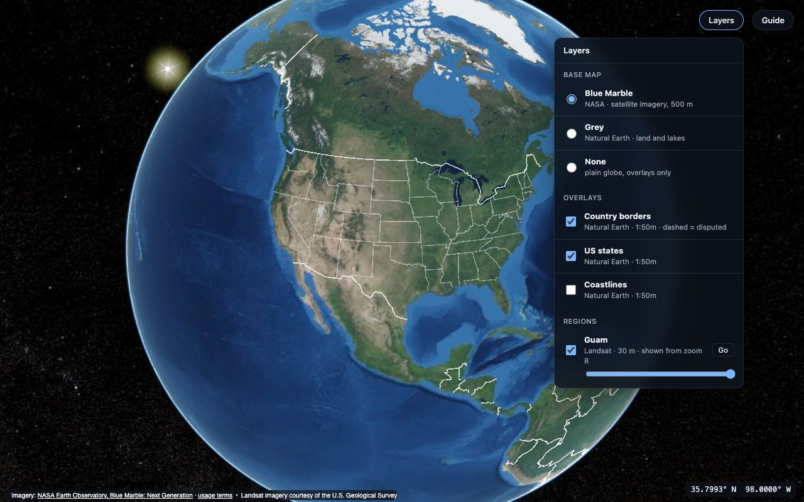
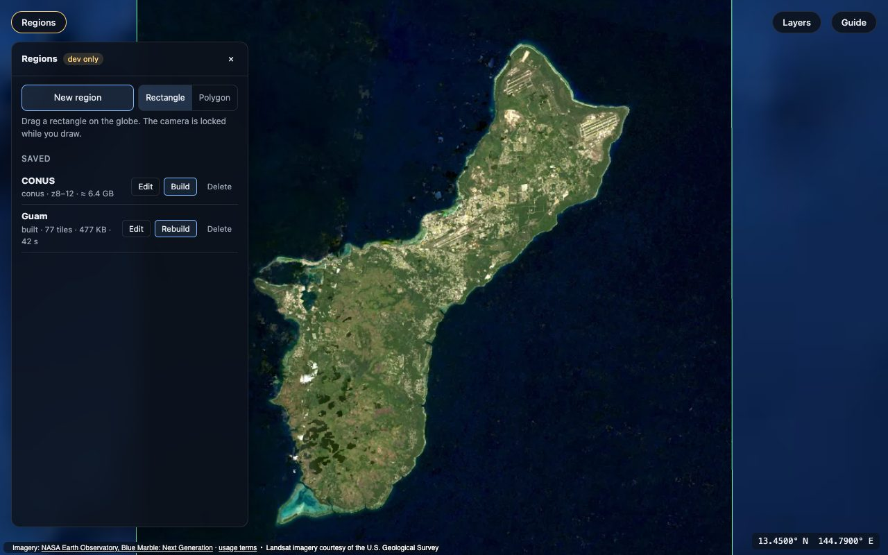
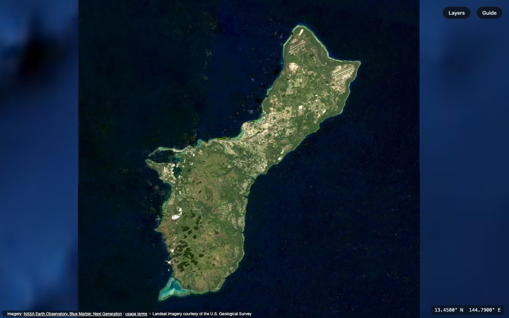
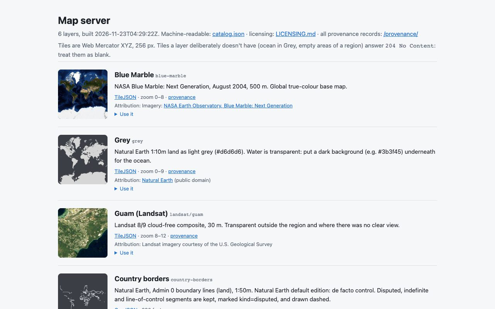

# Blue Marble Globe

A clean CesiumJS globe on self-hosted NASA Blue Marble tiles. It needs no API keys, no online map services and no licence, and every tile can be traced back to the exact NASA files it came from.


- **How to build the map data:** [docs/building-the-tiles.md](docs/building-the-tiles.md)
- **How to add imagery and vector layers in code:** [docs/adding-a-map-layer.md](docs/adding-a-map-layer.md)
- **Why no licence is needed:** [LICENSING.md](LICENSING.md), backed by archived copies of [NASA's usage guidelines](provenance/terms/nasa-images-and-media-guidelines.md)
- **Where every tile came from:** [provenance/](provenance/)

## Quick start

Requirements: Node 26 LTS (`nvm use` reads .nvmrc), Python 3.9+, GDAL 3.9+ (`brew install gdal` on macOS).

```bash
npm install
npm run fetch:source   # ~3 GB from NASA, checksums verified against provenance/sources.json
npm run build:tiles    # Blue Marble: ~350 MB of tiles into public/tiles/blue-marble/, zoom 0-8
npm run build:grey     # optional: the Grey base map (~6 min, ~600 MB on disk)
npm run dev
```

The vector layers (borders, states, coastlines) are already in the repo; `npm run fetch:vectors` regenerates them. **[docs/building-the-tiles.md](docs/building-the-tiles.md)** explains every build step, and is also the Guide's "Build the map data" tab.

`npm run verify:tiles` re-hashes the tiles and checks them against `provenance/build.json`.

`npm test` runs the Playwright browser tests (first time: `npx playwright install chromium`):
- the production globe makes **no requests outside its own origin**
- NASA's credit and terms link are on screen, and the Cesium ion logo isn't
- the Guide panel works, and the dev-only Regions studio is absent from the build
- in dev: drawing, estimating, saving and deleting a region

The HTML report, including a screenshot of the globe, is in `playwright-report/`.

### Disk space

| Path | Size | Kept? |
| --- | --- | --- |
| `data/source/` | 3.0 GB | Kept, so you can rebuild without downloading again. `npm run clean:source` removes it; `fetch:source` re-downloads and re-verifies it. |
| `data/work/` | ~4 GB | Deleted automatically after a successful build (`--keep-work` keeps it) |
| `dist/` | ~1.1 GB | Output of `npm run build`, including a copy of the tiles. `npm run clean` removes it and `data/work/`. |
| `public/tiles/` | ~1.1 GB on disk | The tiles: Blue Marble 357 MB, Grey 132 MB of data but ~600 MB on disk (150,000 small files). Keep them. |

## Layers

The **Layers** button (top right) chooses the base map and switches overlays on and off; the choices are remembered.

<p>
  
  
</p>

**Base map** (pick one):
- **Blue Marble:** NASA satellite imagery
- **Grey:** flat light-grey land on a dark slate ocean, from Natural Earth's 1:10m land and lakes. Build it once with `npm run build:grey` (~6 minutes, ~600 MB on disk, gitignored). The ocean isn't in the tiles: the globe's base colour shows wherever there's no land. Borders and state lines switch to dark grey on this map.
- **None:** no imagery, a plain dark globe, so only the overlays and regions show

**Overlays:**
- **Country borders:** Natural Earth, 1:50m, public domain. Disputed segments are dashed; see `LICENSING.md` for which boundary view this is.
- **US states:** Natural Earth, 1:50m, public domain; fainter lines under the country borders.
- **Coastlines:** Natural Earth, 1:50m, public domain. Off by default, since both base maps already show the coast; it loads the first time you switch it on.

**Regions:**
- **Each built Landsat region:** with an opacity slider and **Go** to fly there. A region shows from its minimum zoom inward.

The vector layers are regenerated with `npm run fetch:vectors`. To add another Natural Earth layer, add an entry to `LAYERS` in `scripts/fetch_vectors.py` and `VECTORS` in `src/layers.js`.

The bottom-right corner shows the latitude/longitude under the cursor, or the centre of the view.

## Guide

The **Guide** button opens the project's own docs inside the app: *Build the map data*, *Add layers in code* and *Serve to other maps*. It renders the files in `docs/` directly, so the app and the docs can't drift apart.


## Regions studio (dev only)

Under `npm run dev`, a **Regions** button (top left) opens a panel for planning higher-resolution regional layers:

<p>
  
  
</p>

*Right: the Guam region, a 30 m Landsat composite, over Blue Marble's 500 m ocean.*

1. Pick **Rectangle** or **Polygon**, press **New region**, and draw:
   - Rectangle: drag on the globe.
   - Polygon: click each corner. You can still move the globe between clicks. Double-click, press Enter, or click the first corner to finish; Backspace removes the last corner, Esc cancels.

   To reshape a saved region, open it from the list and use **Redraw area**.
2. Set the name, date range, months, cloud limit and zoom range. Tile counts per zoom level update live. They're exact, from the Web Mercator grid, and for a polygon they count only the tiles it touches. The size assumes ~20 KB per tile.
3. **Save region** writes `regions/<name>.json` through a small API in the dev server (`server/studio.js`).

Saved regions show as outlines; click one in the list to fly to it and edit it. The panel and its API exist only in the dev server: `npm run build` leaves both out, so the deployed globe is view-only. The API accepts requests only from the app's own page.

### Regional Landsat layers

**Save & build** (or **Build** on a saved region) turns a config into a 30 m Landsat layer over Blue Marble. The build runs on your machine, started by the dev server, and the panel shows it live:

- **Progress card:** each stage (search, download, composite, tile) with a bar and detail, elapsed time, time remaining, a log, and Cancel. It survives a page reload.
- **On the globe:** the chosen Landsat scenes' footprints appear and fill in as their pixels arrive, the composite grid lights up block by block, then the new imagery appears tile by tile.

One-time setup (Homebrew's numpy can be broken, so the project uses its own):

```bash
python3 -m venv --system-site-packages .venv   # keeps access to GDAL's Python bindings
.venv/bin/pip install --ignore-installed -r scripts/requirements.txt
```

A region can also be built from the terminal, which prints the same progress as JSON lines: `npm run build:region -- regions/<name>.json`.

How it works: scenes come from Landsat Collection 2 Level-2 (surface reflectance) via Microsoft Planetary Computer's public catalogue, with no account needed. Only the region's pixels are read from the cloud-optimised files. Clouds and shadows are masked using Landsat's own QA band, and each pixel is the median of the clear views. Tiles are WebP, so areas with no clear view, or outside a polygon boundary, stay transparent and Blue Marble shows through. Completely empty tiles aren't written; each build's `tiles.json` lists the ones that exist, so the globe never requests a tile that isn't there. Each build writes `provenance/regions/<name>.json`: every scene ID, its asset URLs, ETags and sizes, the config, timings and a tile digest.

`npm run test:build` runs an end-to-end test that builds a small area near Boulder through the panel, using the internet and taking about a minute.

Built regions show in the dev studio. Adding them to the production globe is the next step.

## Layout

```
src/main.js                 the whole app: one imagery layer on a bare viewer
src/guide.js                in-app Guide panel (renders docs/*.md: building, adding layers, map server)
src/studio/                 dev-only Regions panel: drawing, tile estimates
server/studio.js            dev-only API: saves regions/*.json, runs and streams builds
scripts/build_region.py     Landsat region build (search, read, composite, tile)
regions/                    saved region configs
scripts/fetch_source.py     download the NASA GeoTIFFs and record their checksums
scripts/build_tiles.py      reproject and tile with GDAL, recording every command
provenance/sources.json     NASA URLs + SHA-256 of the exact source bytes
provenance/build.json       GDAL version, commands, and a digest of all tiles
provenance/terms/           archived copies of the usage terms (NASA, Natural Earth)
provenance/vectors.json     source, checksums and conversion of each vector layer
public/vectors/             vector layers: country borders (426 KB), US states (66 KB), coastlines (1.3 MB); committed
scripts/fetch_vectors.py    fetch + convert Natural Earth vector layers
scripts/build_grey.py       build the Grey base map tiles (Natural Earth land + lakes)
provenance/grey.json        Grey map sources, checksums, commands, timings, tile digest
scripts/build_server.py     map server catalog, TileJSON and index page (-> mapserver/www/)
mapserver/                  map server container: nginx config, Dockerfile
compose.yaml                runs the map server (npm run server:up)
scripts/screenshots.mjs     regenerates the README screenshots in docs/images/ (npm run screenshots)
LICENSING.md                terms, quotes and conditions, with links
NOTICE                      attribution for redistribution
```

The source data (`data/`) and tiles (`public/tiles/`) are gitignored because they are large and fully reproducible. The provenance files are committed.

## Map server

Serves the layers you've built to **any web map** (Leaflet, MapLibre, OpenLayers, Cesium, QGIS) as standard XYZ tiles, TileJSON and GeoJSON, from a Docker container. Needs Docker (Desktop) running.

```bash
npm run server:up      # write the catalog, build the image, start on http://localhost:8080
npm run test:server    # check it end to end (6 tests)
npm run server:down    # stop it
npm run server:build   # after building or rebuilding a layer: refresh the catalog (no restart needed)
```

The full guide is [docs/map-server.md](docs/map-server.md), also in the app's Guide under *Serve to other maps*. Open **http://localhost:8080** for every layer with a preview, its attribution and copy-paste code for each library. Pick a different port with `MAPSERVER_PORT=9000 npm run server:up`.



| URL | What |
| --- | --- |
| `/catalog.json` | Every layer: id, kind, URLs, zoom range, bounds, attribution, licence, provenance |
| `/tiles/<layer>/tilejson.json` | [TileJSON 3.0.0](https://github.com/mapbox/tilejson-spec): all a web map needs, including the attribution |
| `/tiles/<layer>/{z}/{x}/{y}.<ext>` | Web Mercator XYZ tiles, 256 px. Tiles a layer deliberately lacks (ocean in Grey, outside a region) answer **204** (blank), not 404. |
| `/vectors/<name>.geojson` | The vector layers, as-is |
| `/provenance/`, `/licensing`, `/notice` | The build records, LICENSING.md and NOTICE |

For example, in MapLibre, given only the TileJSON URL:

```js
map.addSource("grey", { type: "raster", url: "http://localhost:8080/tiles/grey/tilejson.json", tileSize: 256 });
map.addLayer({ id: "grey", type: "raster", source: "grey" });
```

**How it works.** `scripts/build_server.py` reads the provenance records and writes the catalog, TileJSON and index page to `mapserver/www/` (gitignored). The container is plain nginx (`mapserver/`). The tiles, vectors and provenance are **mounted read-only, not copied**, so the image stays tiny and a rebuilt layer is live straight away. Any site may load the layers (CORS `*`, including Chrome's private-network preflight for LAN use). Tiles are cached for a day, and metadata is always revalidated.

**Addresses.** URLs in the catalog and TileJSON are absolute, built from whatever address a client used (`localhost`, a LAN IP, a hostname). Behind a reverse proxy or CDN, publish one fixed address instead with `python3 scripts/build_server.py --base-url https://maps.example.com`. The proxy terminates TLS; the server honours `X-Forwarded-Proto`.

**Note:** Chrome won't let a page on the public internet load from `localhost` or a private IP, whatever the server allows. For a public site, host the server at a public address.

## Deploying

`npm run build` writes a static site to `dist/`. Copy `public/tiles/` along with it; Vite does this automatically, since the tiles live in `public/`. Any static host works.
