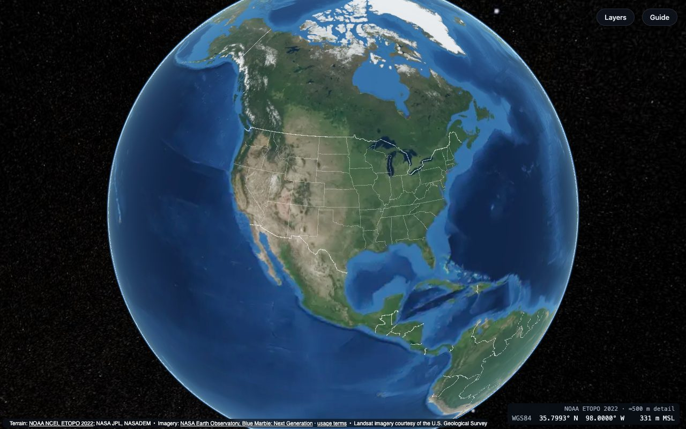
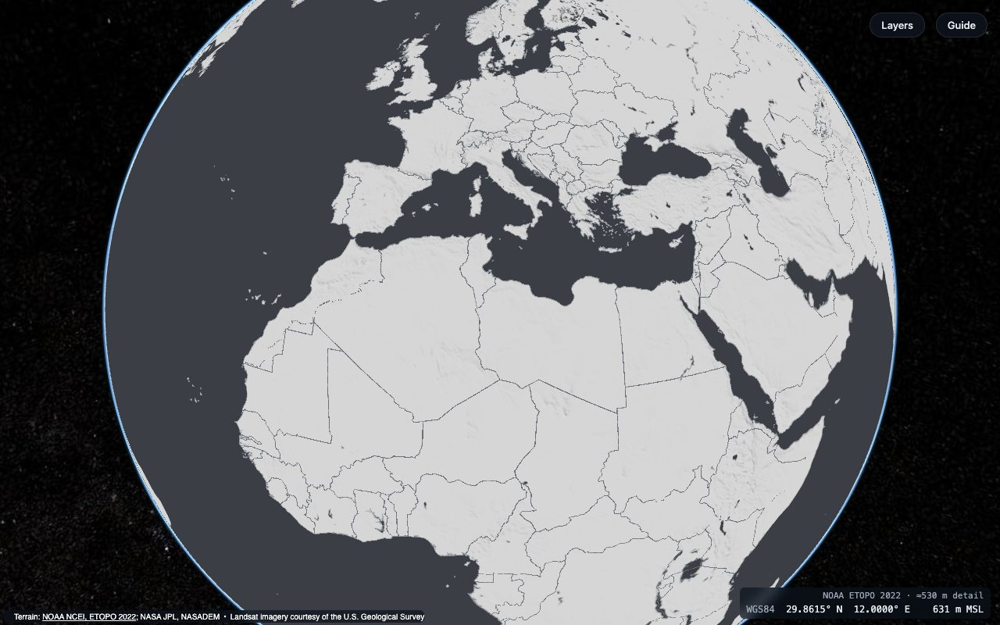
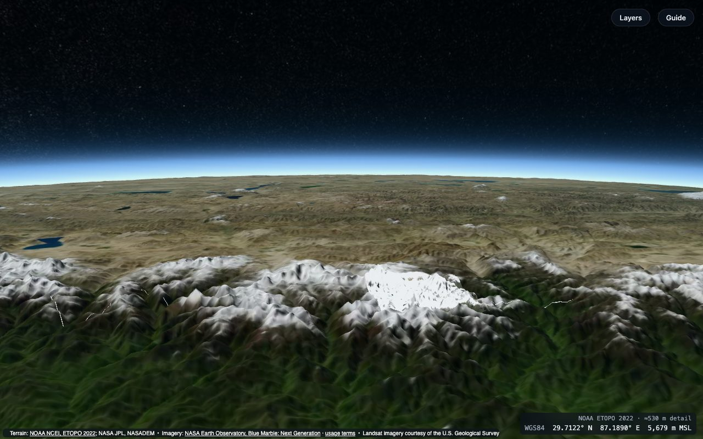
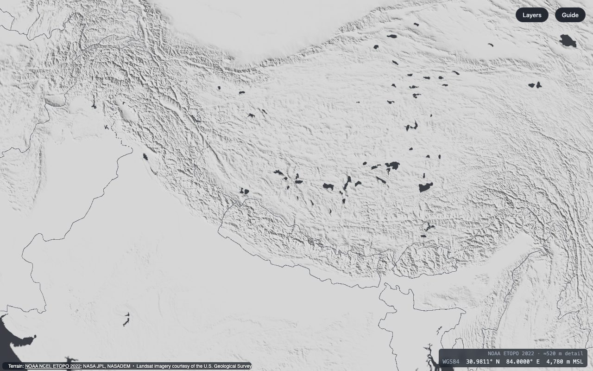
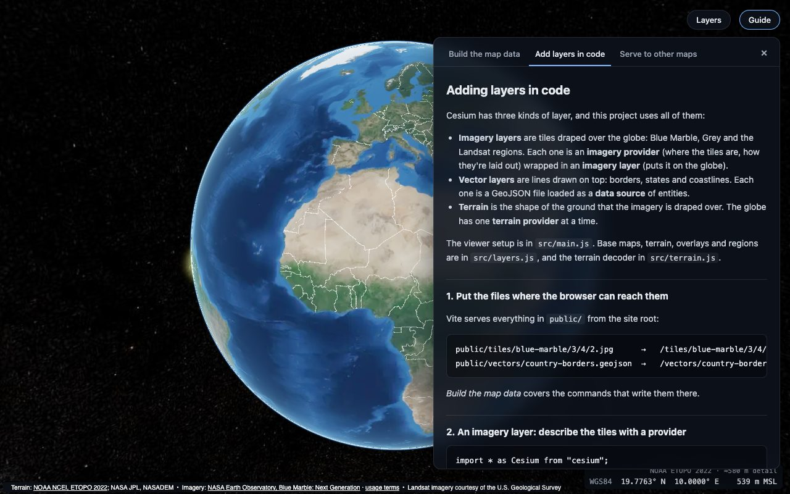
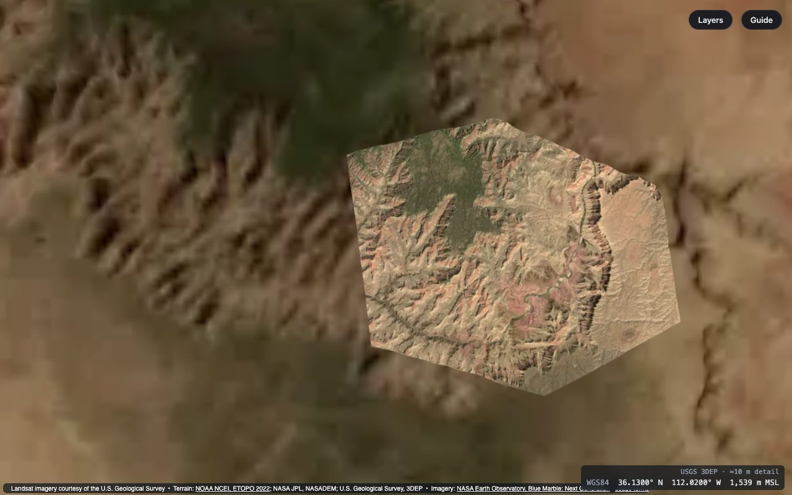
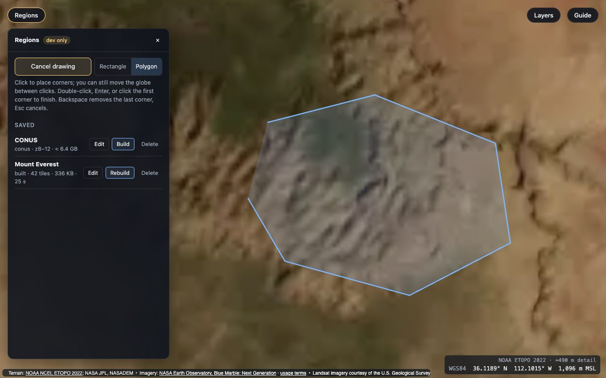
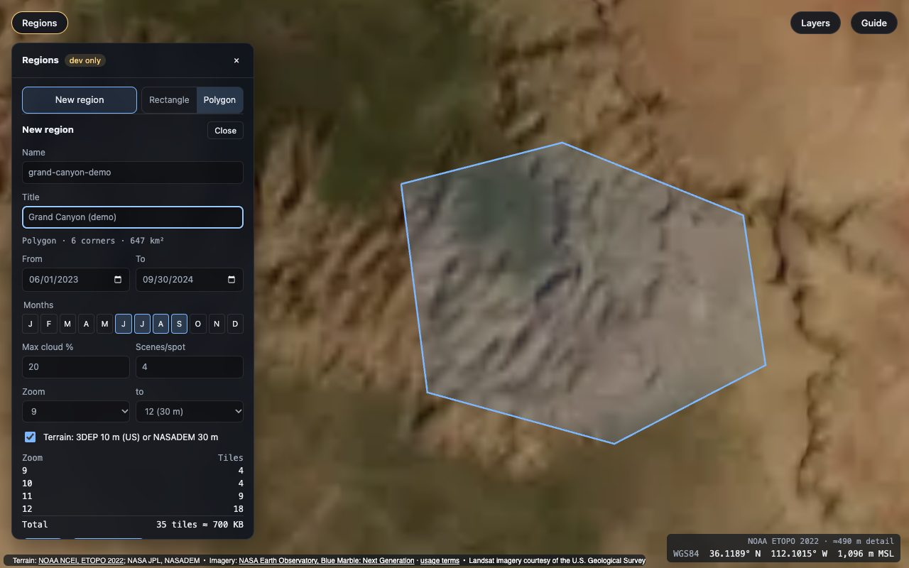
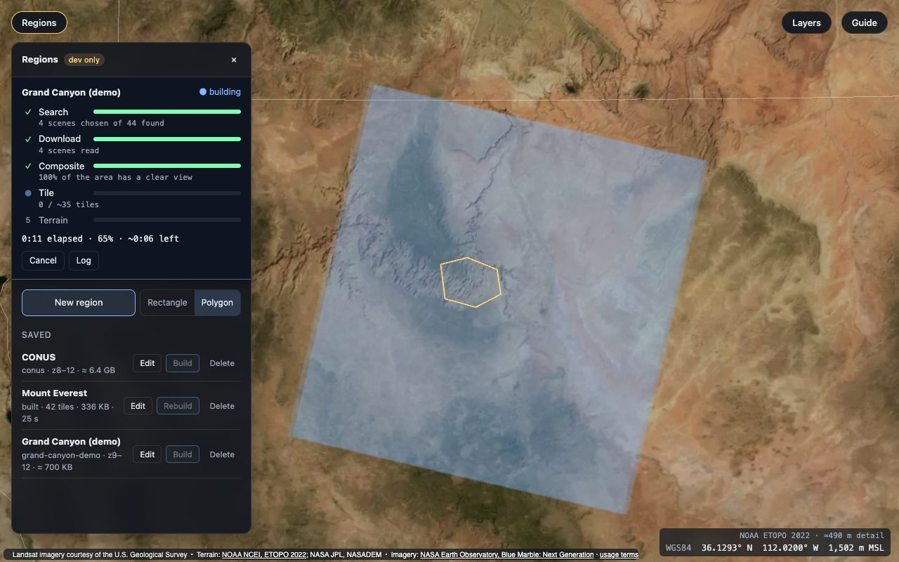

# Blue Marble Globe

A clean CesiumJS globe on self-hosted NASA Blue Marble tiles. It needs no API keys, no online map services and no licence, and every tile can be traced back to the exact NASA files it came from.



**Using it** (once set up, below), all from the map server on your machine:

| | |
| --- | --- |
| **The globe** | http://localhost:8080/globe/ |
| **Add a high-resolution region** | http://localhost:8080/admin/ (sign in, then **Regions**): see [Higher-resolution regions](#higher-resolution-regions) |
| **The layers, for other web maps** | http://localhost:8080/: previews, TileJSON, code |

- **How to build the map data:** [docs/building-the-tiles.md](docs/building-the-tiles.md)
- **How to add imagery and vector layers in code:** [docs/adding-a-map-layer.md](docs/adding-a-map-layer.md)
- **Why no licence is needed:** [LICENSING.md](LICENSING.md), backed by archived copies of [NASA's usage guidelines](provenance/terms/nasa-images-and-media-guidelines.md)
- **Where every tile came from:** [provenance/](provenance/)

## Quick start

Requirements: **Docker** and **Node 26** (`nvm install` reads .nvmrc). All the map building runs inside the map server's **builder** container, whose GDAL, Python and numpy are pinned in `mapserver/builder/Dockerfile`, so every machine builds with exactly the same tools and nothing else needs installing.

```bash
npm install
npm run maps             # builds all the map data in the builder container (about an hour, mostly downloading ~8 GB)
npm run server:password  # in a terminal: choose the admin login (for adding regions)
npm run server:up        # start the map server: the globe, the admin page, the layers
```

Then open http://localhost:8080/globe/.

`npm run maps` runs these steps in order, skipping any that's already built, so you can stop it and run it again to carry on:

| Step | What it makes | Time, size |
| --- | --- | --- |
| `vectors` | borders, states, coastlines | already in the repo: skipped |
| `tiles` | Blue Marble: downloads NASA's files (~3 GB, checksums verified), builds the WebP tiles | ~156 MB of tiles |
| `grey` | the Grey base map | ~9 min, ~150 MB on disk |
| `terrain` | global terrain: downloads NOAA ETOPO (5.2 GB), builds the tiles | ~15 min |
| `catalog` | the map server's catalog | a second |

`npm run maps -- --list` shows what's built; `--only grey` (or `--only tiles,terrain`) runs particular steps; `--force` rebuilds. The downloads stay in `data/source/`, so a rebuild doesn't fetch them again. **[docs/building-the-tiles.md](docs/building-the-tiles.md)** explains every step, and is also the Guide's "Build the map data" tab.

**Working on the app's code?** `npm run dev` runs it from source with instant reload, at http://localhost:5173, Regions panel included. **Building outside Docker** (each step is a script: `npm run build:tiles`, `build:grey`, `build:terrain`, ...) needs Python 3.11+, GDAL 3.6+ with WebP, and numpy on your machine: `npm run doctor` checks them, `scripts/setup-ubuntu.sh` installs them on Ubuntu 24.04, and on macOS `brew install gdal` plus the `.venv` steps under *Higher-resolution regions*.

`npm run verify:tiles` re-hashes the tiles and checks them against `provenance/build.json`.

`npm test` runs the Playwright browser tests (first time: `npx playwright install chromium`; on Ubuntu, `scripts/setup-ubuntu.sh --tests` installs it with its system libraries):
- the production globe makes **no requests outside its own origin**
- NASA's credit and terms link are on screen, and the Cesium ion logo isn't
- the Guide panel works, and the dev-only Regions studio is absent from the build
- in dev: drawing, estimating, saving and deleting a region

The HTML report, including a screenshot of the globe, is in `playwright-report/`.

### Disk space

| Path | Size | Kept? |
| --- | --- | --- |
| `data/source/` | 3.0 GB (+ 5.2 GB with terrain) | Kept, so you can rebuild without downloading again: NASA's files, and NOAA's in `etopo/`. `npm run clean:source` removes them; the next build re-downloads and re-verifies. |
| `data/work/` | ~4 GB | Deleted automatically after a successful build (`--keep-work` keeps it) |
| `dist/` | ~1.1 GB | Output of `npm run build`, including a copy of the tiles. `npm run clean` removes it and `data/work/`. |
| `public/tiles/` | ~1.4 GB on disk | The tiles: Blue Marble ~400 MB (WebP), Grey ~150 MB (identical tiles stored once, as hard links), terrain ~880 MB, regions a few MB each. Keep them. |

## Layers

The **Layers** button (top right) chooses the base map and switches overlays on and off; the choices are remembered.

<p>
  
  
</p>

**Base map** (pick one):
- **Blue Marble:** NASA satellite imagery
- **Grey:** flat light-grey land on a dark slate ocean, from Natural Earth's 1:10m land and lakes. Build it once with `npm run build:grey` (~6 minutes, ~150 MB on disk, gitignored). The ocean isn't in the tiles: the globe's base colour shows wherever there's no land. Borders and state lines switch to dark grey on this map.
- **None:** no imagery, a plain dark globe, so only the overlays and regions show

**Terrain** (needs `npm run build:terrain`):
- Global elevation from **NOAA ETOPO 2022** (about 450 m, public domain), so mountains and canyons stand up when you tilt the view (right-drag or Ctrl-drag).
- The **exaggeration** slider (1× to 5×, default 2×) makes relief visible at globe scale; 1× is true height.
- Land only: the sea stays smooth. Imagery, regions and the border lines drape over it.
- On **Grey** and **None**, which have no shading of their own, slopes are shaded as in a relief atlas (lit from the north-west), computed in the browser from the same tiles.

<p>
  
  
</p>

**Overlays:**
- **Country borders:** Natural Earth, 1:50m, public domain. Disputed segments are dashed; see `LICENSING.md` for which boundary view this is.
- **US states:** Natural Earth, 1:50m, public domain; fainter lines under the country borders.
- **Coastlines:** Natural Earth, 1:50m, public domain. Off by default, since both base maps already show the coast; it loads the first time you switch it on.

**Regions:**
- **Each built Landsat region:** with an opacity slider and **Go** to fly there. A region shows from its minimum zoom inward.

The vector layers are regenerated with `npm run fetch:vectors`. To add another Natural Earth layer, add an entry to `LAYERS` in `scripts/fetch_vectors.py` and `VECTORS` in `src/layers.js`.

The bottom-right corner shows the latitude, longitude and (with terrain on) altitude under the cursor, or at the centre of the view, labelled with what they're measured against: **WGS84** for latitude and longitude (the ellipsoid that is Cesium's Earth model, and GPS's), and **MSL** for altitude (above mean sea level, not the ellipsoid; the two differ by up to about 100 m depending on place). Hover over either for details. The line above says where the altitude comes from and how much detail the terrain has there, e.g. `NOAA ETOPO 2022 · ≈540 m detail`. Altitudes are averages over that distance, so sharp peaks read low: Everest shows about 8,400 m, not 8,849 m.

## Guide

The **Guide** button opens the project's own docs inside the app: *Build the map data*, *Add layers in code* and *Serve to other maps*. It renders the files in `docs/` directly, so the app and the docs can't drift apart.



## Higher-resolution regions

Blue Marble is 500 m per pixel. For a sharper view of a particular place, draw a **region** and the app builds a **30 m Landsat 8/9 layer** for it on your machine: sixteen times sharper, from free public-domain USGS imagery. **Where:** the map server's admin page, **http://localhost:8080/admin/**. Sign in, then press **Regions** (top left). Builds run in the map server's builder container, so nothing but Docker is needed; a finished region appears straight away on the globe (`/globe/`), on the admin page, and in the map server's catalog for other web maps.

<p>
  
  
</p>

### Before you start (once)

1. **The map server is running:** `npm run server:up` (needs Docker).
2. **You have an admin login:** run `npm run server:password` **in a terminal** (it asks for a username and a 12+ character password; Claude Code's `!` prompt can't pass typed input). Change it the same way any time.
3. **An internet connection:** the Landsat imagery and elevation data are read from Microsoft Planetary Computer. No account or API key.

**Or on your own machine instead,** while working on the code: `npm run dev` has the same Regions panel at http://localhost:5173, and builds run with your own Python, GDAL and numpy, in the project's `.venv`. On Ubuntu, `scripts/setup-ubuntu.sh` sets that up. On macOS (Homebrew's numpy can be broken, so the project brings its own):

```bash
python3 -m venv --system-site-packages .venv   # keeps access to GDAL's Python bindings
.venv/bin/pip install --ignore-installed -r scripts/requirements.txt
```

### 1. Draw the area

Open http://localhost:8080/admin/, sign in, and press **Regions** (top left). Choose a shape, press **New region**, and draw on the globe:

- **Rectangle:** drag. The camera is locked while you draw.
- **Polygon:** click each corner. You can still move the globe between clicks. To finish, double-click, press **Enter**, or click the first corner. **Backspace** removes the last corner, **Esc** cancels.

A polygon follows the shape of the place you care about: outside it, the layer stays transparent and fewer tiles are written.



### 2. Choose the settings

When you finish drawing, a form opens. Its tile table updates as you change the zoom range: an exact count from the tile grid and a size estimate (about 20 KB per tile).



| Setting | What it does | Default and tips |
| --- | --- | --- |
| **Name** | The file name: `regions/<name>.json`, `public/tiles/landsat/<name>/` | Lowercase letters, numbers and dashes |
| **Title** | What the Layers menu shows | |
| **From / To** | Which dates' scenes to consider | June 2023 to September 2024. A longer range finds more clear views. |
| **Months** | Which months within that range | June to September: summer, mostly cloud-free and green in the northern mid-latitudes. In the tropics, or wherever it's cloudy year-round, select every month. |
| **Max cloud %** | Skips scenes cloudier than this overall | 20. Clouds in the scenes that are kept get masked out pixel by pixel. |
| **Scenes/spot** | How many of the clearest scenes to combine for each Landsat footprint. Each pixel is the median of its clear views. | 4. More fills more cloud gaps and evens out colour, but downloads more. |
| **Zoom … to** | The zoom levels to build | 8 to 12. Zoom 12 is Landsat's full 30 m. The layer only shows from its first zoom inward; each zoom level out you add costs few tiles. |
| **Terrain** | Builds detailed terrain for the region too | On. USGS 3DEP at 10 m in the US (including Alaska, Hawaii and the territories), NASADEM at 30 m elsewhere between 60° N and 56° S. Beyond those, the region uses the global terrain. Adds about a minute and a few MB. |

**Keep regions modest.** Build time and scratch disk grow with the area. The 714 km² demo above built in under a minute (20 to 45 seconds, mostly reading the imagery), and Mount Everest in 25. A national park or a metro area is fine. A whole state takes hours. Something the size of the continental US can't be built yet; it needs chunked builds, which are on the backlog.

### 3. Save & build

**Save** only writes the config. **Save & build** also starts the build. It runs in the map server's builder container (or, under `npm run dev`, on your machine), and you can watch it:



- **Progress card:** the five stages with progress bars, elapsed time and time remaining. **Log** shows the build's output, and **Cancel** stops it within a second or two. Cancelling keeps the region's previous tiles, if it had any. Reloading the page reconnects to a running build.
  - **Search:** finds Landsat scenes over the area and picks the clearest
  - **Download:** reads only your region's pixels (its bounding rectangle) from each scene, not whole scenes
  - **Composite:** masks clouds and shadows, and takes the median of the clear views
  - **Tile:** cuts web map tiles
  - **Terrain:** reads the region's elevation (3DEP, or NASADEM where 3DEP has none), blends it into the global terrain over its last 2 km so there's no step at the edge, and cuts elevation tiles to zoom 14 (3DEP) or 12 (NASADEM). If it fails, the imagery still stands and the region uses the global terrain.
- **On the globe:** the chosen scenes' footprints appear and fill in as their pixels arrive. The composite lights up block by block, and then the new imagery appears tile by tile.

### 4. The result

When the build finishes, the region appears on the globe automatically, here as sharp 30 m imagery inside the polygon over Blue Marble's 500 m blur:


- It's listed under **Layers → Regions**, with a toggle, an opacity slider and **Go** to fly there. It shows up in the production build too (`npm run build`).
- **The map server** lists and serves it straight away: the build refreshes the server's home page and catalog when it finishes.
- **Files:**
  - `regions/<name>.json`: the config. Commit it.
  - `provenance/regions/<name>.json`: the record of every Landsat scene used, with its URLs, ETags and sizes, plus the timings and a digest of the tiles. Commit it.
  - `public/tiles/landsat/<name>/`: the tiles, with the region's terrain in `terrain/`. Gitignored, and rebuildable from the config.
- **Its terrain** takes over from the global terrain inside the region while the region is switched on. The readout then names it: `USGS 3DEP · ≈10 m detail` (Everest's summit reads about 8,770 m against 8,490 m on the global terrain, whose 600 m averages flatten it; the surveyed height is 8,849 m, and NASADEM's 30 m cells still round the very top off).

### Managing regions

- **Click a region's name** in the panel to fly to it. Click **Edit** to change its settings, and **Redraw area** to reshape it.
- **Build** or **Rebuild** builds it again with its current settings. One build runs at a time.
- **Delete** (click again to confirm) removes the config only. To remove a region's layer too, delete `public/tiles/landsat/<name>/` and its provenance file, then run `npm run build:region -- --index` to update the layer list.
- **From the terminal:** `npm run build:region -- regions/<name>.json` builds a saved region with your own Python (the `.venv` above) and prints progress as JSON lines. Or, with only Docker: `docker compose exec builder python3 scripts/build_region.py regions/<name>.json`.

The panel and its API exist only in the dev server and the map server's admin page. `npm run build` and the map server's public `/globe/` leave both out, so those are view-only. The API also refuses requests from any page other than the app's own, and on the map server it needs a signed-in session.

### How it works

Scenes come from Landsat Collection 2 Level-2 (surface reflectance), through Microsoft Planetary Computer's public catalogue. Only the region's pixels are read from the cloud-optimised files. Clouds and shadows are masked using Landsat's own quality band, and each pixel is the median of the clear views. Tiles are WebP, so areas with no clear view, or outside a polygon, stay transparent and Blue Marble shows through. Completely empty tiles aren't written; each build's `tiles.json` lists the ones that exist, so the globe never requests a missing tile. USGS Landsat imagery is public domain (see [LICENSING.md](LICENSING.md)), and the globe credits USGS on screen.

Terrain: `scripts/region_terrain.py`. It searches 3DEP and NASADEM, then reads the region's pixels once onto the grid of its deepest zoom, 3DEP first and NASADEM only for gaps. Elevation tiles use the same encoding as the global terrain, except that the blue channel holds the region's share of each height (255 inside, fading to 0 at the edge), which the readout uses. The record lists every elevation file used.

`npm run test:build` builds a small area near Boulder through the panel, end to end. It uses the internet and takes about a minute. `npm run screenshots -- --regions-only` retakes the screenshots above by building a demo region and then deleting it.

## Layout

```
src/main.js                 the whole app: one imagery layer on a bare viewer
src/guide.js                in-app Guide panel (renders docs/*.md: building, adding layers, map server)
src/studio/                 Regions panel (dev server and admin page): drawing, tile estimates
src/datasource.js           the Server status light
server/studio-api.js        Regions API: saves regions/*.json, runs and streams builds
server/studio.js            ... plugged into the dev server (npm run dev)
server/admin-api.js         ... and the builder container's own server, with sign-in (server/auth.js)
scripts/build_region.py     Landsat region build (search, read, composite, tile)
regions/                    saved region configs
scripts/build_maps.py       every map build step in order (npm run maps, in the builder container)
scripts/fetch_source.py     download the NASA GeoTIFFs and record their checksums
scripts/build_tiles.py      reproject and tile with GDAL, recording every command
provenance/sources.json     NASA URLs + SHA-256 of the exact source bytes
provenance/build.json       GDAL version, commands, and a digest of all tiles
provenance/terms/           archived copies of the usage terms (NASA, Natural Earth)
provenance/vectors.json     source, checksums and conversion of each vector layer
public/vectors/             vector layers: country borders (426 KB), US states (66 KB), coastlines (1.3 MB); committed
scripts/fetch_vectors.py    fetch + convert Natural Earth vector layers
scripts/build_grey.py       build the Grey base map tiles (Natural Earth land + lakes)
scripts/build_terrain.py    build the global terrain tiles (NOAA ETOPO 2022)
src/terrain.js              turns the terrain tiles into Cesium terrain
provenance/terrain.json     terrain sources (288 files' checksums), encoding, timings, tile digest
provenance/grey.json        Grey map sources, checksums, commands, timings, tile digest
scripts/build_server.py     map server catalog, TileJSON and index page (-> mapserver/www/)
scripts/dedupe_tiles.py     stores identical tiles once (hard links, at most 60,000 per copy)
scripts/admin-password.sh   sets the admin login (npm run server:password)
scripts/make-cert.sh        HTTPS certificate from a private CA (npm run server:cert)
scripts/bundle.sh           offline bundle for air-gapped networks (npm run bundle)
scripts/setup-ubuntu.sh     building outside Docker: installs everything on Ubuntu 24.04
scripts/doctor.py           building outside Docker: checks every dependency (npm run doctor)
mapserver/                  map server containers: nginx config, builder, sign-in page, offline bundle files
compose.yaml                runs the map server and builder (npm run server:up)
scripts/screenshots.mjs     regenerates the README screenshots in docs/images/ (npm run screenshots [-- --regions])
LICENSING.md                terms, quotes and conditions, with links
NOTICE                      attribution for redistribution
```

The source data (`data/`) and tiles (`public/tiles/`) are gitignored because they are large and fully reproducible. The provenance files are committed.

## Map server

Serves the layers you've built to **any web map** (Leaflet, MapLibre, OpenLayers, Cesium, QGIS) as standard XYZ tiles, TileJSON and GeoJSON, from a Docker container. Needs Docker (Desktop) running.

```bash
npm run server:up      # write the catalog, build the image, start on http://localhost:8080
npm run test:server    # check it end to end (MAPSERVER_ADMIN=user:password to include the signed-in tests)
npm run server:down    # stop it
npm run server:build   # refresh the catalog by hand (every build already does it when it finishes)
```

The full guide is [docs/map-server.md](docs/map-server.md), also in the app's Guide under *Serve to other maps*. Open **http://localhost:8080** for every layer with a preview, its attribution and copy-paste code for each library. Pick a different port with `MAPSERVER_PORT=9000 npm run server:up`.


| URL | What |
| --- | --- |
| `/catalog.json` | Every layer: id, kind, URLs, zoom range, bounds, attribution, licence, provenance |
| `/tiles/<layer>/tilejson.json` | [TileJSON 3.0.0](https://github.com/mapbox/tilejson-spec): all a web map needs, including the attribution |
| `/tiles/<layer>/{z}/{x}/{y}.<ext>` | Web Mercator XYZ tiles, 256 px. Tiles a layer deliberately lacks (ocean in Grey, outside a region) answer **204** (blank), not 404. |
| `/tiles/terrain/…`, `/tiles/landsat/<region>/terrain/…` | Elevation tiles (Terrarium encoding): the global terrain and each region's. MapLibre shows them as 3D terrain and hillshading. |
| `/vectors/<name>.geojson` | The vector layers, as-is |
| `/provenance/`, `/licensing`, `/notice` | The build records, LICENSING.md and NOTICE |

For example, in MapLibre, given only the TileJSON URL:

```js
map.addSource("grey", { type: "raster", url: "http://localhost:8080/tiles/grey/tilejson.json", tileSize: 256 });
map.addLayer({ id: "grey", type: "raster", source: "grey" });
```

**The map server serves the globe too**, at **http://localhost:8080/globe/** (linked from its home page): the same app, on the same address as its data, so it needs no settings and no cross-origin rules, and anyone who can reach the server can use it. `npm run server:up` builds it (`npm run server:globe` on its own: a production build into `mapserver/globe/`, without the tiles, which the server already has). It's the viewer only, with an **Admin** pill (top left) leading to the admin page.

**The admin page** is the globe plus the **Regions** panel, at **http://localhost:8080/admin/**, behind the app's own sign-in page. Region builds started there run in a second container, the **builder** (GDAL 3.13.3, Python, numpy and Node, from OSGeo's official image), so the map server's machine needs nothing but Docker:

```bash
npm run server:password   # once, in a terminal: choose the admin username and password (stored hashed, not committed)
npm run server:up         # builds the globe, the admin page and both images, then starts both containers
```

- **nginx stays the only way in.** It serves maps and the globe publicly, and lets `/admin/` and `/api/` through only with a signed-in session (a 12-hour cookie; **Sign out** in the Regions panel ends it). The builder isn't published on any port.
- **The builder writes only the data folders** (regions, tiles, provenance, scratch space and the catalog), as you, not root. nginx keeps read-only access to everything.
- **Builds can't starve the map server:** the builder is capped at 4 CPUs and 6 GB of memory (`BUILDER_CPUS`, `BUILDER_MEMORY` to change).
- **Finished regions appear straight away** on the globe, the admin page, the home page and the catalog.
- **Images:** builder about 820 MB, map server about 90 MB. A machine that only serves maps can run just the map server.

**HTTPS and air-gapped networks.** Put a certificate in `mapserver/tls/` and the server switches to HTTPS (`npm run server:cert` makes one from a private CA, for networks without their own). For a network without internet, `npm run bundle` packs the server and all the map data into one folder; its `install.sh` installs or updates a **serve-only** server (no admin page) with nothing but Docker, after checking every file's checksum. See [docs/map-server.md](docs/map-server.md), sections 6 and 7.

**A separately run globe can use the server too.** By default the globe loads map data from its own site. Start or build it with the server's address, and it takes all of it (tiles, terrain, regions, lines) from the map server instead:

```bash
VITE_MAP_SERVER_URL=http://localhost:8080 npm run dev      # or ... npm run build
```

To make it stick on your machine, put the setting in `.env.local` (not committed; `.env.example` shows it), and restart `npm run dev`. Delete the file, or empty the value, to go back to local files. The tests always run on local files, whatever `.env.local` says.

A **Server** light under the **Layers** and **Guide** buttons shows whether the map server is answering: green, or red with **Server offline**. It follows the data requests themselves, plus a health check every 30 s. Hover over it for the address. A globe reading its own files has no light.

**How it works.** `scripts/build_server.py` reads the provenance records and writes the catalog, TileJSON and index page to `mapserver/www/` (gitignored). The container is plain nginx (`mapserver/`). The tiles, vectors and provenance are **mounted read-only, not copied**, so the image stays tiny and a rebuilt layer is live straight away. Any site may load the layers (CORS `*`, including Chrome's private-network preflight for LAN use). Tiles are cached for a day, and metadata is always revalidated.

**Addresses.** URLs in the catalog and TileJSON are absolute, built from whatever address a client used (`localhost`, a LAN IP, a hostname). Behind a reverse proxy or CDN, publish one fixed address instead with `python3 scripts/build_server.py --base-url https://maps.example.com`. The proxy terminates TLS; the server honours `X-Forwarded-Proto`. (Or let the server do HTTPS itself: see above.)

**Note:** Chrome won't let a page on the public internet load from `localhost` or a private IP, whatever the server allows. For a public site, host the server at a public address.

## Deploying

`npm run build` writes a static site to `dist/`. Copy `public/tiles/` along with it; Vite does this automatically, since the tiles live in `public/`. Any static host works.
